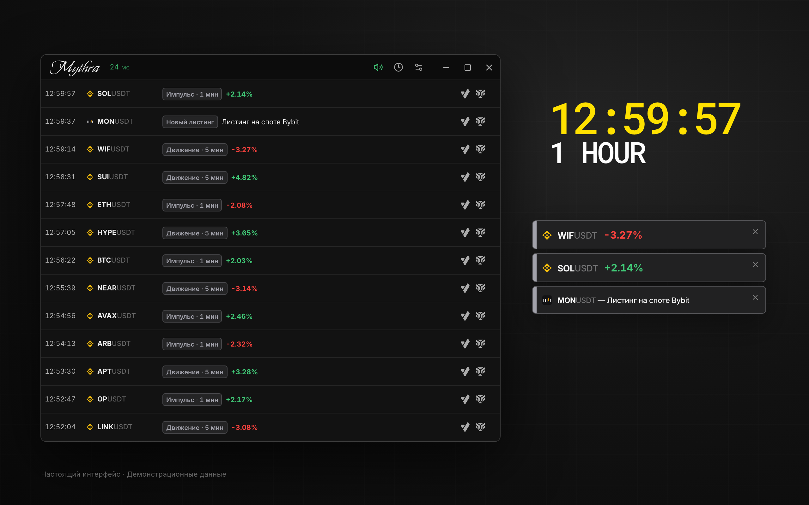
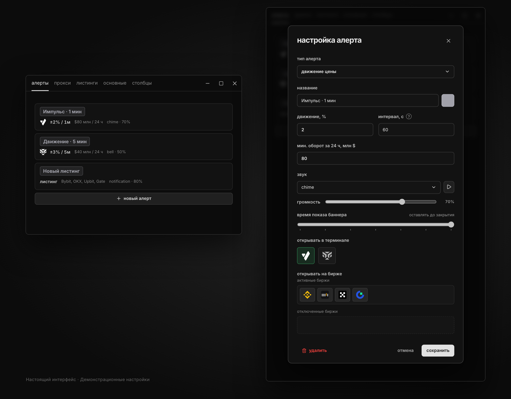

<h1 align="center">Mythra</h1>

<p align="center">
  <strong>Импульсы, листинги и алерты — рядом с вашим терминалом.</strong>
</p>

<p align="center">
  
</p>

<p align="center">
  <a href="https://github.com/scythe0x/cryptotape/releases/latest/download/Mythra.exe"><strong>Скачать для Windows</strong></a>
  · <a href="https://github.com/scythe0x/cryptotape/releases">Все версии</a>
</p>

<p align="center">
  Windows 11 · x64 · Бесплатно · Без регистрации, активации и подписки
</p>

Mythra следит за движениями USDT-фьючерсов Binance и сообщает, когда цена проходит заданный процент за выбранный интервал. Настройте условия под свою торговлю, оставьте компактную ленту рядом со стаканом и открывайте нужный тикер в Vataga или Tiger.Trade.

## Что умеет

- **Ловить движения в обе стороны.** Задайте процент, интервал и минимальный оборот за сутки. Создайте несколько правил для разных ситуаций.
- **Сообщать так, как удобно вам.** Свой цвет, звук, громкость и время показа баннера для каждого правила. Звук и баннеры можно отключать независимо — события останутся в ленте.
- **Открывать тикеры в терминале.** Вручную из ленты или автоматически по правилу. Порядок бирж — Binance, Bybit, OKX и Gate — настраивается.
- **Показывать внешние листинги.** Выбирайте биржи и типы событий. Для этой функции нужен отдельный ключ [newlistings.pro](https://newlistings.pro/); бесплатный тариф источника добавляет задержку 3 секунды. Ценовые алерты работают без этого ключа и без API-ключа Binance.
- **Держать время перед глазами.** Отдельные часы поверх окон, выбор часового пояса и подсветка перед закрытием пятиминутной свечи. Перед завершением часа, четырёх часов и суток появляется подпись.

## Начать за минуту

1. [Скачайте Mythra.exe](https://github.com/scythe0x/cryptotape/releases/latest/download/Mythra.exe) и запустите. Установщик не нужен. Если Windows попросит WebView2, установите [Microsoft WebView2 Runtime](https://developer.microsoft.com/en-us/microsoft-edge/webview2/).
2. Откройте **Настройки → алерты → новый алерт** и выберите тип **движение цены**.
3. Задайте условия, выберите звук и сохраните правило. Например:

   | Параметр | Пример |
   | --- | --- |
   | Название | Импульс · 1 мин |
   | Движение | 2% |
   | Интервал | 60 секунд |
   | Минимальный оборот за 24 часа | 80 млн $ |

4. Оставьте приложение открытым. При срабатывании событие появится в ленте; звук, баннер и автооткрытие выполнятся по настройкам правила.

Правило реагирует и на рост, и на падение. Интервал — максимальное время движения: если порог пройден быстрее, ждать его окончания не нужно.

После сигнала тот же тикер по тому же правилу делает паузу, равную интервалу. Другие тикеры и правила продолжают работать; события во время паузы не накапливаются для отправки позже.

<details>
<summary>Как выглядят список правил и настройка алерта</summary>

<p>
  
</p>

</details>

## От алерта к терминалу

Нажатие на тикер копирует его название. Кнопки Vataga и Tiger справа открывают инструмент в выбранном терминале. Для автооткрытия включите нужный терминал в настройке правила и расставьте биржи по приоритету.

- **Vataga:** запустите терминал; его локальный API должен быть доступен на порту `5005`.
- **Tiger.Trade:** включите локальный сервер сигналов и привяжите нужные окна к группе линковки. В **Настройки → основные** укажите тот же порт и группу; по умолчанию — `7819` и `A`.

Mythra открывает инструмент. Заявки вы выставляете в терминале.

## Обновления и данные

Чтобы обновиться, закройте Mythra и замените exe на файл из [последнего релиза](https://github.com/scythe0x/cryptotape/releases/latest). Правила, история и импортированные звуки сохранятся: они хранятся отдельно, в `%APPDATA%\cryptotape`. Автоматического обновления нет.

Интерфейс доступен на русском и английском. Язык, монитор уведомлений и прокси для подключения к Binance выбираются в настройках.

## Build from source

Понадобятся **Go 1.26.10+**, **Node.js 22+** с npm, **WebView2 Runtime** и **Wails 3 CLI**. Команды для PowerShell на Windows из корня репозитория:

```powershell
go install github.com/wailsapp/wails/v3/cmd/wails3@v3.0.0-beta.33
$env:CGO_ENABLED = "0"
wails3 task build:windows
.\build\bin\Mythra.exe
```

`wails3` должен быть доступен в `PATH`. Сборка создаёт самостоятельный exe со встроенным интерфейсом и звуками.

[Руководство по разработке](docs/development.md) — запуск из исходников, macOS, тесты, проверки производительности, устройство сигналов и выпуск релизов.
